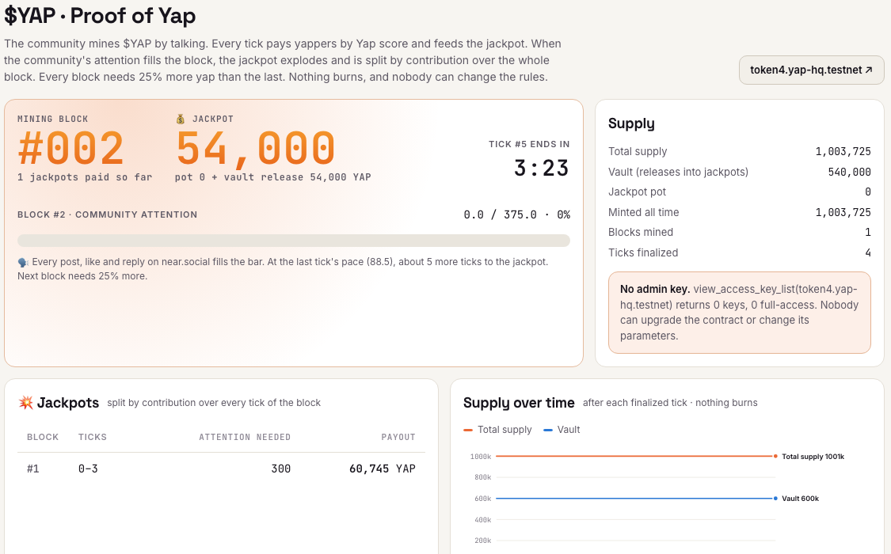
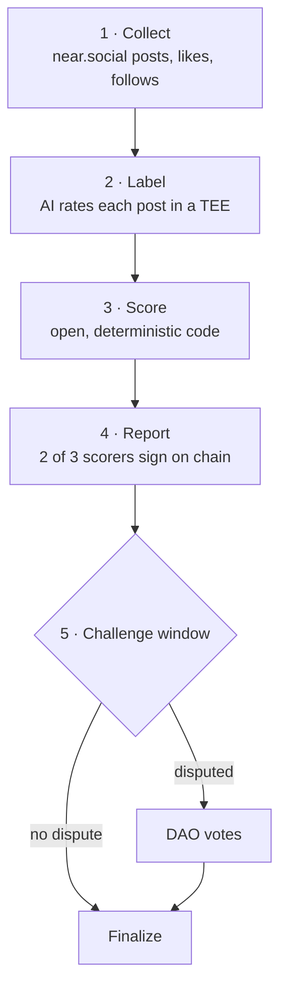

<p align="center">
  
</p>

<h1 align="center">$YAP</h1>

<h3 align="center">Make Yap Great Again.</h3>

<p align="center">
  <b>Proof of Yap: the community mines $YAP by talking.</b><br/><br/>
  💬 <b>Yap and earn.</b> Every 10 minutes your near.social posts are scored, and you get paid in $YAP.<br/>
  💥 <b>Fill the bar, pop the jackpot.</b> Everyone's yap fills a shared bar. When it's full, the jackpot explodes<br/>
  and is split by how much you yapped during the whole block.<br/>
  ⛏ <b>Then it gets harder.</b> The next jackpot needs 25% more yap than the last.<br/><br/>
  🤖 <b>Bots don't get paid:</b> a NEAR AI model in a TEE reads every post, and spam earns zero.<br/>
  🔒 Nothing burns, and the contract has zero access keys, so nobody can change the rules. Not even us.
</p>

<p align="center">
  <a href="https://yap-near.vercel.app/#/token">
    
  </a>
</p>

<p align="center">
  <b>▶ <a href="https://yap-near.vercel.app">Live demo</a></b> (NEAR testnet, nothing to install) ·
  🎥 <a href="https://x.com/HenryphamPo/status/2119834848730997109">3-minute stack walkthrough on X</a> (recorded for v2, before Proof of Yap)
</p>

<p align="center">
  
  
  
  
  
</p>

<p align="center">
  <a href="#the-30-second-version">Pitch</a> ·
  <a href="#live-on-testnet">Live on testnet</a> ·
  <a href="#how-it-works">How it works</a> ·
  <a href="#dont-trust-verify">Verify</a> ·
  <a href="#run-it">Run it</a> ·
  <a href="#limits-honestly">Limits</a>
</p>

---

## The 30-second version

**The game: Proof of Yap.** The community mines $YAP the way miners mine Bitcoin, except the work is talking.

| | What happens |
| --- | --- |
| 🗣 **You yap** | Every 10-minute tick (1 day on mainnet) you earn $YAP by Yap score: post quality × engagement from trusted accounts |
| 📈 **The community fills the block** | Each tick's total attention fills a shared progress bar. 20% of every mint drips into the jackpot |
| 💥 **The block fills** | The jackpot explodes: everything in the pot plus 10% of the 600,000 YAP vault, **split by contribution over the whole block**, not only the final tick |
| ⛏ **Difficulty rises** | The next block needs 25% more attention, so every jackpot is harder to reach than the last |
| 🤫 **Nobody talks** | Nothing burns. The bar just waits, and unclaimed rewards flow back into the jackpot |

Your payout depends on everyone else: the faster the community yaps, the sooner the jackpot drops, and the more you
yapped during the block, the bigger your share. Near the end of a block everyone wants to be in the tick that fills it.

**Bots don't get paid.** Yap-to-earn dies when bots farm it, so every post is read by `Qwen/Qwen3.8-27B` running in
a TEE on **NEAR AI Cloud** (Intel TDX + NVIDIA attestation, checked on every call). The model labels each post
`0 spam · 1 low · 2 normal · 3 insightful`. Spam and bot repetition get `0`, and a `0` post earns nothing however many
likes it collects. The prompt hash, labels hash and attestation hash go on chain with every report, so anyone can
check the model and the rules were not swapped. In our stress test, AI labels alone cut a 100-bot spam farm from 87%
to 48% of the payout. Together with stake-weighted PageRank and the per-pair like cap, which catch like-rings that
an AI can't see, the farm drops to 27% ([details](#stress-test-we-attacked-our-own-scoring)).

**Why it exists:** on **15 Jan 2026** X banned apps that reward posting. The next day Kaito shut down Yaps, the product behind about
70% of its token's utility. **One API decision deleted a whole category.**

$YAP rebuilds the Kaito Yaps feature set on **near.social**, where every post, like, repost, reply and follow is a
NEAR transaction (FastData KV writes to the `social` account). The data is public chain data, so there is no API key
for anyone to revoke.

|  | What it means |
| --- | --- |
| **The meme does something** | Proof of Yap: talking fills a shared block, a full block explodes the jackpot, and every block needs 25% more yap. |
| **Nobody holds the off switch** | Every parameter is fixed at launch. The token contract has **zero access keys**: no admin, no upgrade, no pause. |
| **The community owns the treasury** | A stock **Sputnik DAO v2** (works in Trezu) gets 10% of every mint, funds topic **Arenas**, and is the **court of appeal** for scoring disputes. |
| **Reputation becomes membership** | Gold+ yappers join the DAO's `trusted` role through an immutable steward contract and a Merkle proof. No council vote, no admin. |
| **AI that can prove itself** | Post quality is labelled by `Qwen/Qwen3.8-27B` in a verified TEE (Intel TDX + NVIDIA attestation). The label hash goes on chain. |
| **Every point is checkable** | Open scoring code and published data. Anyone can recompute any epoch in the browser and challenge it. |

---

## Live on testnet

Everything below runs on NEAR testnet with real transactions. Epochs last **10 minutes** on testnet (mainnet would
use 1 day).

**Live deployment (v4, Proof of Yap): [`token4.yap-hq.testnet`](https://testnet.nearblocks.io/address/token4.yap-hq.testnet),
mining since 14 Nov 2026, 02:30 UTC.** Block #1 needs 300 attention (about an hour of a lively community). The current
block, jackpot, every jackpot paid and every tick are on the [$YAP page](https://yap-near.vercel.app/#/token), read
straight from the chain. The scorers, watchdog, steward keeper and @yapbot run under a supervisor that restarts them
on failure and keeps every contract funded for its own storage.

<details>
<summary><b>Earlier runs (v2 <code>token2</code>, 8–14 Nov · v3 <code>token3</code>, 14 Nov): the burn mechanic we replaced</b></summary>

v2 ran the same contract for six days: 33 epochs finalized, best streak 5, and the watchdog caught and challenged a
deliberately tampered report (links below). Its many dead epochs came partly from silent stretches we ran on purpose
to exercise the burn, and partly from hours when our single scorer host was offline. The contract handled both the
same way: nobody reported, so anyone could call `crank_dead_epoch` and 10% of the Reserve burned. That is the rule
working, but it left v2's Reserve almost empty. We relaunched as v3 with a supervised runner, then replaced the burn
mechanic with Proof of Yap (v4): punishing silence made a quiet week look like a broken token, while a jackpot that
grows with the community rewards exactly the behaviour a memecoin wants. v2 and v3 stay on chain; v2's full
transaction log is in [docs/TESTNET-v2.md](docs/TESTNET-v2.md).

</details>

| Piece | Account |
| --- | --- |
| $YAP token (NEP-141 + mechanics, **locked**) | [`token4.yap-hq.testnet`](https://testnet.nearblocks.io/address/token4.yap-hq.testnet) |
| Community DAO (Sputnik v2, council of 3, 2 to pass) | [`dao.yap-hq.testnet`](https://testnet.nearblocks.io/address/dao.yap-hq.testnet) |
| Steward (reputation → DAO `trusted` role, capped grants, **locked**) | [`steward4.yap-hq.testnet`](https://testnet.nearblocks.io/address/steward4.yap-hq.testnet) |
| Scorers (bonded, 2-of-3 identical report hash) | `scorer-1..3.yap-hq.testnet` |
| Independent watchdog (recomputes every report, challenges mismatches) | [`watchdog.yap-hq.testnet`](https://testnet.nearblocks.io/address/watchdog.yap-hq.testnet) |
| @yapbot (answers "how am I doing?" on near.social) | [`yapbot.yap-hq.testnet`](https://testnet.nearblocks.io/address/yapbot.yap-hq.testnet) |
| AI quality labeler | `Qwen/Qwen3.8-27B` in a verified TEE on NEAR AI Cloud |
| Testnet community: 15 writers, plus 4 spam bots and a 5-account like-ring to attack the scoring | `y01..y24.yap-hq.testnet` |

**On-chain moments worth clicking** (v4 lock first, then highlights from the v2 run):

- v4 token locked, all full-access keys deleted:
  [`5XMgZR9jVu…`](https://testnet.nearblocks.io/txns/5XMgZR9jVupjtm4qJt138gDczAT2wPND5h2P4LW3EX1P)
- v2 token locked the same way:
  [`DXLV1MBDMF…`](https://testnet.nearblocks.io/txns/DXLV1MBDMFfcVcz962NPLzgpRX5sJerGfmgU5VhCn2Rm)
- Watchdog catches a tampered report (our collusion test) and challenges it:
  [`3g35hmDnpg…`](https://testnet.nearblocks.io/txns/3g35hmDnpgz6QDT7ssLdMRXceDYsu6GWu2LjW5K8yRjs) ·
  [`GaNxcg8tkV…`](https://testnet.nearblocks.io/txns/GaNxcg8tkVS7WJhbHEPwJ89LjnyfRpxAHA8uW7FAT9qX)
- DAO proposal funds the `#near` Arena from the treasury:
  [`7DbVug9ohm…`](https://testnet.nearblocks.io/txns/7DbVug9ohmCfH84SXD6PmbtVJ7MRmhFs5DVbRn48uMN9)
- Steward promotes a Gold yapper into the DAO by Merkle proof:
  [`9r786Yud5H…`](https://testnet.nearblocks.io/txns/9r786Yud5HmvjYiCEgEsKtF4M7QyBzJiCnjTHT5yxaGq)

Every transaction is listed in **[docs/TESTNET.md](docs/TESTNET.md)**, and the app's $YAP page shows them live.

---

## How it works

Every epoch goes through five steps:



1. **Collect.** Read every near.social write in the epoch and hash the dataset (`data_hash`).
2. **Label.** The TEE-attested model rates each post. The labels are hashed (`labels_hash`).
3. **Score.** Integer-math scoring that anyone can rerun and get the same result.
4. **Report.** Bonded scorers post the result. 2 of 3 must sign the same hash.
5. **Challenge.** Anyone can bond YAP to dispute a report. The token contract then opens a Sputnik DAO proposal,
   and the council rules on it.

When an epoch finalizes, the community's attention is compared with a moving target:

Then the tick settles on chain:

| Step | Rule |
| --- | --- |
| **Mint** | `base emission × attention / target`, capped at 3×. The target follows attention by EMA |
| **Feed the jackpot** | 20% of the mint goes to the jackpot pot. The rest: **80% to yappers** (Merkle claim), **10% to sYAP stakers**, **10% to the DAO** |
| **Fill the block** | The tick's attention is added to the block's progress |
| **Explode** | Progress ≥ threshold: pot + 10% of the vault is added to this tick's claim tree, split by each account's Yap score summed over every tick of the block. The next threshold is 25% higher |
| **Silence** | A tick nobody reports mints nothing and adds nothing. Nothing burns |

Rewards left unclaimed for 14 ticks return to the jackpot. Full rules are in [RULES.md](RULES.md), and the scoring formulas
with a worked example are in [docs/SCORING.md](docs/SCORING.md).

### The Yap score

1. **Smart followers.** PageRank over the near.social follow graph, with teleport weighted by stake. The top 20% are
   "smart".
2. **Quality.** Each post gets a label `q ∈ {0 spam, 1 low, 2 normal, 3 insightful}` from the TEE-attested model at
   temperature 0, with a fixed prompt whose hash is in the report. Labels are the only non-deterministic input, and
   their hash is on chain.
3. **Engagement.** Likes, reposts, replies and quotes are weighted by the engager's rank, smart status and stake.
   Self-engagement and same-epoch new accounts are ignored. At most 3 actions per engager → author pair count.
4. **Score.**

   ```
   post score = Q[q] × (1 + ln(1 + engagement))
   Yap score  = sum of the best 10 posts   (halved with no smart followers and no stake)
   ```

**Tiers** come from the trailing 30-epoch percentile: Inner Circle (top 1%) · Gold (top 10%) · Silver
(top 30%) · Bronze (any score). Arenas can require a tier.

### The Trusted circle

- The steward contract checks a Gold+ yapper's Merkle leaf against a finalized epoch, then adds them to the DAO's
  `trusted` role.
- Trusted members can send small, capped treasury grants: **300 YAP each, 1,500 per season.**
- Membership expires each season unless it is re-earned.

---

## Don't trust, verify

The trust model is built so that nobody, including us, has to be trusted:

| Who | What they can do | What stops them |
| --- | --- | --- |
| **Deployer (us)** | Nothing after launch | The token and steward have no access keys. Parameters have no setters. |
| **Scorers** | Propose an epoch report | 2 of 3 must sign the identical hash, each posts a bond, and the bond is slashed if a challenge is upheld. |
| **Anyone** | Recompute and challenge | Scoring after labels is deterministic. Run `watchdog`, or open the **Verify** page. |
| **The DAO** | Rule on challenges, fund Arenas | Votes are public Sputnik proposals, opened by the token contract itself. |
| **The AI** | Label post quality | Runs in an attested TEE (nonce-bound). The prompt hash, labels hash and attestation hash are all in the report. |

The **Verify** page downloads an epoch's dataset and labels, reruns the scoring code in your browser, and checks
every hash and root against the chain.

---

## Kaito feature → YAP

| Kaito | $YAP on NEAR |
| --- | --- |
| Yap points | Yap score per tick, paid in $YAP by Merkle claim, plus a share of every block's jackpot |
| Mindshare | Treemaps for accounts and topics (#hashtags, $cashtags, @accounts), with time windows and movers |
| Smart followers | Stake-weighted PageRank over the near.social follow graph |
| Yapper leaderboards | Global and per-topic leaderboards, rank change, tier |
| Project campaigns | **Arenas**: funded by DAO proposal, tier-gated, paid per epoch |
| Staked token boosts | **sYAP**: extra engagement weight plus the stakers' share |
| Anti-slop filters | TEE-attested AI labels, hashed on chain |
| Closed scoring | Open code and published data. Recompute any epoch on the Verify page. |

### The app ([web/](web/))

| Page | What you do there |
| --- | --- |
| **Mindshare** | See who and what the community is talking about |
| **Yapper Leaderboard** | Global and per-topic ranks, tiers, rank change |
| **Profile** | Score history, best posts, followers, and a downloadable Yap card |
| **Arenas** | Topic campaigns, plus a builder for DAO funding proposals |
| **Feed** | Post, like, repost, reply and follow on near.social from a burner wallet |
| **Earn** | Claim rewards, stake sYAP |
| **$YAP** | The block being mined, its progress bar, the jackpot, every jackpot paid, ticks on chain, and the lock proof |
| **Verify** | Recompute an epoch in the browser |
| **Governance** | DAO proposals and the Trusted circle |
| **Stress test** | 60-epoch attack and economy scenarios |

The app also has a **mainnet read-only** mode. It ranks real near.social mainnet yappers over the last 30 days, with
posts labelled by the same TEE-attested model. This mode pays no rewards.

### @yapbot

Mention `@yapbot.yap-hq.testnet` on near.social with "how am I doing?" or "how is @someone doing?". An agent gathers
the published scores, the AI labels with their reasons, the tier and the Trusted-circle status. A model in a verified
TEE then writes a short reply grounded only in those facts, and posts it on chain as a reply.

---

## Stress test: we attacked our own scoring

Before trusting the scoring with real money, we threw attackers at it. The test runs the production scoring code and
the contract's exact emission math over 60 epochs of attack traffic, switching each defence on and off.

Share of yapper emission the attackers captured (mean over 60 epochs):

| Attacker | No defences | PageRank | AI labels | Pair cap | Stake weight | **All defences** |
| --- | ---: | ---: | ---: | ---: | ---: | ---: |
| Spam farm (100 bots) | 87.0% | 76.1% | 48.1% | 85.3% | 86.3% | **26.9%** |
| Like ring (10 accounts) | 52.3% | 42.3% | 52.2% | 35.9% | 50.8% | **19.1%** |

No single defence is enough. Together they cut the spam farm from 87% to 27%.

The same 60-epoch runs also play out the economy. A steady community mines 11 blocks and pays 482,078 YAP in
jackpots; in the **dead-meme** scenario the community goes silent at epoch 20, nothing burns, the bar simply stops
and the vault keeps 318,865 YAP for when people come back. Full results and method are in [sim/RESULTS.md](sim/RESULTS.md); every run is
reproducible from seed `20261107`.

---

## Repository

```
contracts/yap/      Rust NEP-141 token + mechanics (near-sdk 5.30.1)      → API: contracts/yap/API.md
contracts/steward/  Rust steward: reputation → DAO trusted role, capped grants
indexer/            FastData KV `social` → canonical epoch dataset (data_hash)
scoring/            PageRank, engagement, Yap score, tiers, mindshare, Merkle (integer math)
agents/             deploy, crowd seeder, TEE labeler, scorer, watchdog, steward keeper, @yapbot
sim/                60-epoch stress test (attacks + economy) → web/public/sim.json, sim/RESULTS.md
web/                Vite + React 19 app
docs/               TESTNET.md (real tx log), SCORING.md (formulas + worked example)
```

**Built with:** near-sdk-rs · near-contract-standards · near-workspaces · Sputnik DAO v2 · near.social +
FastData KV · NEAR AI Cloud (TEE) · near-api-js · TypeScript · React.

---

## Run it

**Requirements:** Node 23, pnpm 10, Rust 1.95 (pinned in `rust-toolchain.toml`) and `cargo near`.

The fastest way to look around is the hosted app: **https://yap-near.vercel.app** (reads NEAR testnet live; the
`Mainnet · read-only` switch shows the real near.social board). To run everything locally:

```bash
pnpm install
pnpm -r test                 # scoring + indexer + sim tests (vitest)
cargo test -p yap -p steward # contract unit tests + sandbox tests with the real Sputnik DAO wasm
pnpm sim                     # 60-epoch stress test
pnpm -C web dev              # the app → http://localhost:5180
```

<details>
<summary><b>Testnet operator commands</b> (keys live in <code>~/.near-credentials/testnet</code>, never in the repo)</summary>

```bash
pnpm -C agents deploy                       # sub-accounts, Sputnik DAO, token, scorer bonds, delete full-access keys
pnpm -C agents seed --setup                 # testnet community profiles + follow graph
pnpm -C agents crowd                        # testnet community activity (busy and slow ticks)
pnpm -C agents scorer                       # index → label (TEE) → score → publish → report → finalize → claims
pnpm -C agents watchdog                     # independent audit + automatic challenge on mismatch
pnpm -C agents yapbot                       # @yapbot: answers mentions on near.social
pnpm -C agents mainnet --days 30            # read-only mainnet board with TEE labels
pnpm -C agents gov arena '#near' 500 6 1    # DAO proposal: fund an arena from the treasury
pnpm -C agents gov vote <id>                # council votes (2 of 3)
pnpm -C agents steward deploy               # steward contract + council ChangePolicy + lock
pnpm -C agents steward keeper               # promote Gold+ yappers each finalized epoch, demote expired ones
pnpm -C agents steward grant <from> <to> <YAP> <memo>   # a trusted member's capped treasury grant
```

`NEARAI_API_KEY` in `.env` enables the real labeler. Without it, labels fall back to a deterministic
heuristic.

</details>

---

## Limits, honestly

- **Sybil resistance makes farming expensive, not impossible.** A patient ring of aged accounts writing decent AI text
  still earns about 19% in our stress test. The DAO challenge and the per-epoch tier gate are the backstop.
- **Labels come from one model.** The hash is on chain, but a different model would label differently. Each post is
  labelled once, then cached.
- **The 3 scorers sign independently, but on testnet they run from one service.** Scoring after labels is
  deterministic, so any third party can run `watchdog` and challenge.
- **near.social mainnet is small today** (about 130 accounts), so the live economy runs on testnet,
  and the mainnet board is read-only.
- **The testnet deploy flow differs from a production launch.** On testnet, init is a separate transaction from the
  deploy. A mainnet launch should deploy, init and lock in one batch.

---

## Built during NEAR HACKATHON 2026

Everything in this repository was written during NEAR HACKATHON 2026 (7–14 Nov 2026). Two pieces were adapted
from existing code rather than written from scratch: the NEAR AI attestation checker and the Sputnik sandbox test
pattern.

The UI is our own brand. Kaito is named only as background.

**License:** MIT
